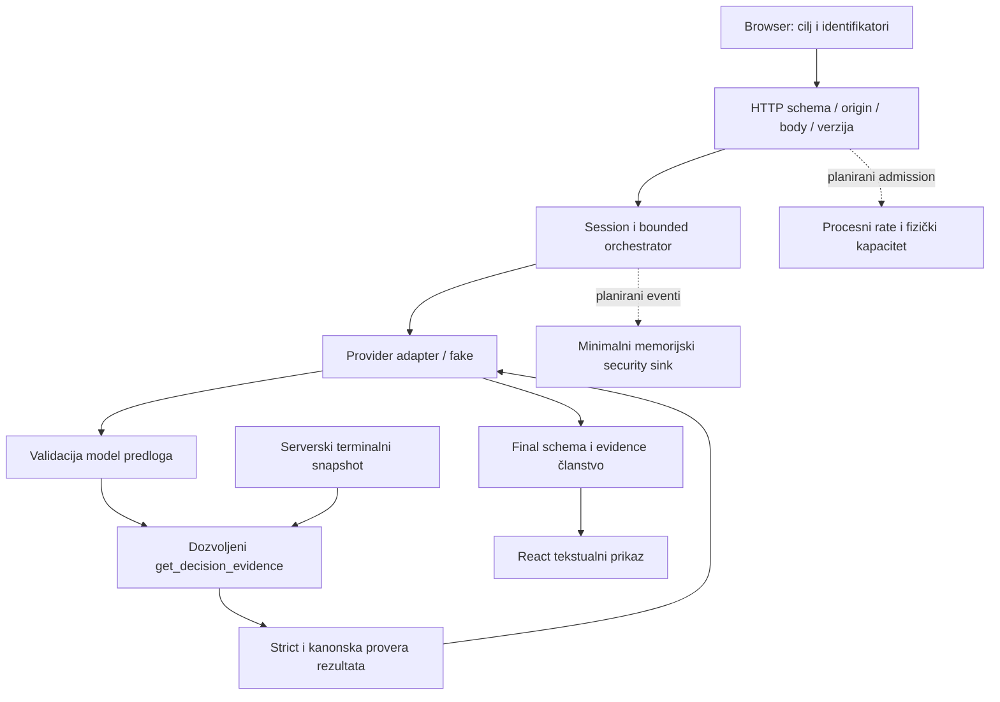

# EVIDENCE_W08 — Secure the Arcade

**Datum pripreme: 2026-10-25. Status: plan i lokalna osnova spremni; Week08 nije završen.**
**Dopuna 2026-10-26:** T004 završen na osnovi commita `0d361f1`; sačuvan
[početni prompt](BUILD_PROMPT_WEEK08_V1.md), potvrđeni T001–T003 i ponovljene
fokusirane provere: 57 testova i 6 recovery E2E PASS. [T004 dokaz](evidence/005-T004-handoff.md).
Security implementacija još nije počela; sledeći task je T005.
Struktura prati nastavni šablon. Planirano nije izvršeno; stare W05/privatne
dorade nisu novi W08 doprinos. Finalnu matricu popunjavati stvarnim opažanjima.

## 1. Opseg i checkpoint

- Tim: Veki i Milan; stvarni rad/review u §10.
- Projekat: Retro Poker, postojeći W05 „Coaching partije”, read-only alat
  `get_decision_evidence`, dva modelska koraka; fake provider i sintetički podaci.
- Repo: `poker-app`, Git koren roditelj `retro-poker/`.
- Početni branch/commit: `week08-init`, `96fb9715098d8a3bf857103c855335b302a30d36`.
  Isti commit kao `add-modifications`; frontend PR prema korisniku čeka Milanov review.
- `git fetch origin` izvršen 2026-10-25; `origin/main` je
  `c73ae8c1a995122987eb54662536ab11488ad6f6`, review tip
  `2574a0aeb64a592b91882569629f8b8dc6cccf96`. PR status nije nezavisno čitan preko GitHub API-ja.
- Posle selektivnog prenosa: isti HEAD + [patch osnove](evidence/005-baseline-transfer.patch)
  i [hash manifest](evidence/005-baseline-snapshot.json). Nije napravljen novi commit,
  main/PR nisu merged; root korisnički `.gitignore` sačuvan.
- Završni W08 checkpoint: **još ne postoji**.
- Windows, Node 24.20.0/npm 11.19.0; Chromium iz Playwright 1.63.0.
- Lokalni jedan proces/jedna partija u memoriji, loopback, bez naloga/cookie auth-a
  ili privatne multi-user arhive. To nije zaštita od drugih lokalnih procesa.

| Početna provera | Stvarni ishod | Dokaz |
|---|---|---|
| `npm.cmd test` pre prenosa | FAIL: 905/906, 61/62 fajla; offline CLI test timeout 5 s | [prvi izlaz](evidence/005-baseline-tests-before.txt) |
| Recovery E2E pre prenosa | PASS 5/5 | [prvi recovery](evidence/005-baseline-recovery-before.txt) |
| `npm.cmd test` posle prenosa | PASS 906/906, 62 fajla | [testovi](evidence/005-baseline-tests-after.txt) |
| Puni E2E posle prenosa | PASS 20/20, uključujući novi slow-forward recovery | [E2E](evidence/005-baseline-e2e-after.txt) |
| Typecheck / lint / build | PASS, exit 0 za svaku komandu | [typecheck](evidence/005-baseline-typecheck.txt), [lint](evidence/005-baseline-lint.txt), [build](evidence/005-baseline-build.txt) |
| Postojeći coach evidence helper | Sandbox pokušaj nije startovao zbog tsx/OS ENOMEM; odobren ponovni offline run exit 0, osam scenarija | [prvi pokušaj](evidence/005-baseline-coach.txt), [stvarni run](evidence/005-baseline-coach-retry.txt) |
| Clean `npm ci` / novi GitHub CI | NOT RUN u ovoj pripremi | Otvoren T029; postojeći node_modules nije clean-install dokaz |

Normalan baseline fixture je versionisan u `tests/helpers/coach-evidence.ts`:
game `00000000-0000-4000-8000-000000000001`, hand `...0002`, expectedVersion 5,
factsRevision 1, status lost, jedna flop call odluka, goal street, fake
`agent_tool`→`agent_final`, stvarni lokalni executor. Očekivanje unapred zapisano:
completed, 2 model koraka/2 pokušaja/1 stvarni alat, nepromenjen snapshot.
Stvarni helper run to potvrđuje. Lifecycle test u full suite-u dodatno koristi
kontrolisan all-in kraj partije i poredi kompletno poker stanje. Ovo je dokaz
funkcionalne osnove; nije završna W08 matrica niti live provider dokaz.

Detaljan prenos i reprodukcija: [baseline](evidence/005-baseline.md).

## 2. Arhitektura i inventar podataka

Isprekidane veze još nisu implementirane. HTTP trust boundary je browser→server;
provider i tool izlaz su nepoverljivi čak i kada u testu dolaze iz fake-a.

| Podatak/capability | Ko kontroliše | Provera/upotreba | Ide modelu? | Čuvanje / razlog |
|---|---|---|---|---|
| goal.focus | Browser predlaže | Strict enum + vezivanje run/tool focus-a | Da | Run u memoriji, korisnikov fokus |
| gameId/handId/version | Browser šalje; server autoritet | Session poređenje sa aktuelnom partijom | Ne kao ovlašćenje; evidence ref može sadržati handId | Identifikacija resursa, nije session/bearer token |
| factsRevision/snapshot | Server | Zamrznut terminalni snapshot, canonical validators | Samo dozvoljena projekcija | Tekuća partija/run, do zamene/restarta |
| Činjenice odluka | Server engine | Do 200 odluka, tool izbor do 10; dozvoljene činjenice | Da, odabrane sopstvene/javne informacije | Koristan coaching bez cele arhive |
| Špil, burn/skrivene tuđe karte, RNG | Server | Public view i knowledge projection | Ne | Interna igra, bez response/model/log izvoza |
| Tool name/args | Model predlaže | Allowlist, strict args, scope pre izvršenja | Predlog/validirani rezultat | Run, ne operativni raw log |
| Tool output/final | Nepouzdan output | Byte/schema/canonical članstvo pre nastavka/UI-ja | Samo validan tool output drugom modelu | Bounded run rezultat; plain text UI |
| Model/API config i ključ | Server env/adapter | Fiksan config, SDK mock/sentinel test planiran | Ključ ne ide u model context | Proces; tajne nisu deo test fixture-a |
| Browser state/URL/storage | Korisnik može menjati | Nisu kanonski izvor poker stanja; nema učitavanja partije iz storage-a | Ne direktno | UI stanje; T15 proverava granicu |
| AI usage | Serverski brojači | Epoch/revizija, dashboard/reset | Ne | Memorija do reset/restart; nije security audit |
| Greške/security događaji | Server iz nepoverljivih događaja | Safe code i planirana allowlist event schema | Ne | Plan: max 200/30 min, lokalni proces, bez javnog endpoint-a |

Nema korisničkog imena/slobodnog coaching teksta, replay importa, SQL-a ili RAG-a
na izabranom toku. Ne dodavati izmišljene izvore u dijagram. Postojeće tekstualne
provider rezultate ipak tretirati kao nepoverljive.

## 3. Model pretnji i prioriteti

Procena je kvalitativna za lokalni demo, ne potvrđena eksploatacija.

| ID | Scenario i preduslov | Resurs; verovatnoća × uticaj | Postojeća kontrola / nedostatak | Planirani dokaz | Prioritet |
|---|---|---|---|---|---|
| R1 | Lokalni klijent šalje više uzastopnih coach/analysis startova mimo dugmeta | Provider rad/trošak; srednja × visoka: direktan endpoint lako ponoviti | Run budžet i dedupe; nema cross-request rate prozora | T13, 5/60 s i legitimni oporavak | **1** |
| R2 | Provider ignoriše abort; korisnik menja partiju i pokreće novi posao | Procesni kapacitet; srednja × visoka: stale zaštita ne prekida nužno rad | Race/abort i stale guard; treba meriti stvarni active maximum | T12/T13/T17 | **2** |
| R3 | Validan final sadrži script/event HTML ili opasni link | Browser igrača; niska × visoka: React tekst je dobra kontrola, production CSP nedostaje | Plain text; nema CSP/header browser dokaza | T04/T05/T16 | **3** |
| R4 | Klijent dodaje model/maxSteps/role ili podmeće poker stanje | Autoritet/stanje; srednja × visoka: zahtevi su izmenljivi | Strict schema i server state | T01–T03/T15, pozitivni control | Ostalo obavezno |
| R5 | Model predloži inherited tool ili validne args van run scope-a | Alati/podaci; srednja × visoka: model nije pouzdan | Zatvoren name dispatch, snapshot/goal provere | T07–T09, real executor spy | Ostalo obavezno |
| R6 | Tool vrati tuđe facts/extra secret polje ili adapter raw grešku | Poverljivost; niska × visoka: postoje projekcija i safe errors | Canonical validator; sentinel dokaz nedostaje | T10/T14/T16 | Ostalo obavezno |
| R7 | Raw tool name sa novim redom postane operativni log | Integritet evidencije; srednja × srednja ako se uvede raw logging | Nema novog security sink-a; dizajn mora izbeći raw log | T14, bounded event schema | Ostalo obavezno |

Prva tri daju najveću korist nad trenutno nedokazanim granicama. Ostali se ne
preskaču. Multi-user BOLA/SQL injection/RAG import nisu izabrane putanje jer te
funkcije ne postoje; UUID i loopback se ne predstavljaju kao autentikacija.

## 4. SpecKit/SDD invarijante i granice

Spec: [feature 005](../specs/005-week08-secure-the-arcade/spec.md).
Jedina tabela konkretnih limita: [plan](../specs/005-week08-secure-the-arcade/plan.md).
Ugovor: [security](../specs/005-week08-secure-the-arcade/contracts/security.md).

| Invarijanta | Mesto postojeće / planirane kontrole | Zahtev i dokaz |
|---|---|---|
| I1 | app/routes/session input i planirani admission | FR-002/003/013; T01–T03/T13 |
| I2 | strict shared schema, server config/snapshot | FR-002/003/006; T02/T08/T15 |
| I3 | orchestrator/tools/validation | FR-004/005; T06–T10 |
| I4 | snapshot, canonical state i lifecycle | FR-001/003/007; T00/T12/T15/T17 |
| I5 | tekstualni paneli + planirani preview headers | FR-009/010; T04/T05/T16 |
| I6 | run limits + planirani gate/lease/output token cap | FR-006–008; T11–T13/T17 |
| I7 | allowlist projections/errors + planirani events/sentinel | FR-005/011–014; T10/T14/T16/audit |
| I8 | normalan fake tok i full regresija | FR-001/015; T00 i završne provere |

Ovo je mapa implementacije, ne lista završenih kontrola. Konkretni test fajlovi
i tačni izvršeni testovi dopunjavaju se po tasks-u.

## 5. Rezultati scenarija T00–T17

Finalni status svih redova je **NOT RUN** do W08 izvršavanja. Postojeći baseline
signali nisu automatski preneti u završne PASS ocene.

| ID | Fixture/ulaz i očekivanje pre testa | Početno opažanje / planirani test | Final |
|---|---|---|---|
| T00 | Sintetička terminalna partija, 2 model koraka/1 real tool, read-only | Baseline helper i full lifecycle PASS; `security-normal.test.ts` tek sledi | NOT RUN |
| T01 | Nevalidan JSON/tip/domain, pozitivan boundary; 0/0 poziva | `security-http.test.ts`; postojeći route testovi su samo osnova | NOT RUN |
| T02 | Odvojeno oversized body i extra privilege polja; 0/0 | `security-http.test.ts` | NOT RUN |
| T03 | Nepoznata/zastarela partija; dozvoljena trenutna prolazi | `security-http.test.ts`; single-user scope, bez fiktivnog auth-a | NOT RUN |
| T04 | Final sa XSS markerom i normalnim tekstom; bez izvršenja/opasnog DOM-a | `security-rendering.spec.ts`, pravi browser | NOT RUN |
| T05 | HTML/Markdown/javascript link/image; neaktivni tekst | `security-rendering.spec.ts` | NOT RUN |
| T06 | Invalid/oversized model, nema success/novog koraka | `security-tools.test.ts` | NOT RUN |
| T07 | Unknown/constructor/toString, nula tool efekata, validan tool prolazi | Baseline unknown_tool PASS u helper-u; inherited varijante tek slede | NOT RUN |
| T08 | Loši args i zasebno validan args/pogrešan scope | `security-tools.test.ts` | NOT RUN |
| T09 | Malicious fake predlog uprkos promptu | `security-tools.test.ts`; nema slobodnog input kanala | NOT RUN |
| T10 | Oversized/invalid/extra sentinel/tuđ tool rezultat; nema sledećeg model curenja | `security-tools.test.ts` + secrets | NOT RUN |
| T11 | Ponavljanje i ukupni attempts/retry/fallback odvojeno | `security-budgets.test.ts`; helper ima samo deo baseline scenarija | NOT RUN |
| T12 | Per-call, zbirni deadline i late rezultat zasebno | `security-budgets.test.ts` + lifecycle | NOT RUN |
| T13 | Overlap maximum i 5/60 prozor odvojeno, recovery | `security-admission.test.ts`, capacity test | NOT RUN |
| T14 | Učitan sentinel u grešci/tool polju + forged log newline | `security-secrets.test.ts` + events | NOT RUN |
| T15 | Izmenjen browser zahtev/state/storage bez serverskog efekta | `security-state.spec.ts` + HTTP test | NOT RUN |
| T16 | Build/header/CSP/sentinel, dostupan zabranjeni script + normalna igra | `security-production.spec.ts`; sadašnji build PASS nije CSP dokaz | NOT RUN |
| T17 | Noncooperative job→new game/reset→new start→late result | `security-lifecycle.test.ts`; prelazi resursnu i state/usage granicu | NOT RUN |

T00–T15 i T17 automatizovati. T04/T05 stvaran browser, T16 automatizacija ili
precizni ručni dokazi. Po izvršenju upisati stvarne brojače, state comparison,
komandu i checkpoint, ne samo status. Odbijen početni HTTP: provider/tool 0/0;
odbijen model proposal može imati provider 1, ali nedozvoljeni tool 0.

### CSRF i origin

Pregledani kod nema automatski auth cookie/credential; credential CSRF je
arhitektonski N/A, ne izvršeni PASS. Cross-origin cost test ipak obavezan:
drugi lokalni Origin/null → 0 provider/0 tool; validan origin → normalan tok.
SQL N/A jer nema baze. Ako se model promeni, ove odluke ponovo otvoriti.

### Dependency audit

NOT RUN. T027 upisuje komandu/exit, paket, stvarnu lockfile verziju, advisory,
runtime/dev uslov izloženosti i odluku (fixed/mitigated/N/A uz dokaz/open).
Nedostupna mreža nije clean audit. Ne koristiti `audit fix --force`.

## 6. Poređenje pre/posle

Najmanje tri scenarija, isti fixture/ulaz. T006 ih izvršava pre security koda.
Prenos review test infrastrukture ne predstavlja tri security popravke.

| Scenario | Pre checkpoint/ulaz/rezultat | Promena | Posle isti ulaz/rezultat | Ograničenje |
|---|---|---|---|---|
| T07 unknown/inherited tool | NOT RUN kompletan W08 fixture; helper je baseline signal | Očekivana postojeća zaštita, PASS→PASS dozvoljen | NOT RUN | Ne dokazuje sve model generacije |
| T13 burst accepted starts | NOT RUN; broj i fake-time raspored sačuvati u T006 | Planirani rate/capacity gate | NOT RUN | Jedan proces, bez distribuiranog load testa |
| T16 CSP blocked script | NOT RUN; sačuvati isti server/resurs/marker | Planirana preview HTTP zaglavlja | NOT RUN | Lokalni build, nije deploy audit |

## 7. Arhitektura, tajne i security događaji

Plan: admission/capacity i mali memorijski event sink u `backend/src/security/`.
Bez novog servisa ili javnog log API-ja. Fake se ubrizgava konstruktorom; normalan
backend koristi postojeći adapter. Sentinel `W08_SERVER_SECRET_DO_NOT_EXPOSE`
je planirana sintetička vrednost, ne pravi ključ.

Još nema izvršenog sentinel testa, stvarnog W08 accepted/rejected event primera
niti dokaza retention-a. T023–T026 ih popunjavaju. Predviđeno čitanje događaja:
lokalni proces/operator/test sink; max 200/30 min, bez trajnog zapisivanja,
restart uklanja buffer, usage reset ga ne briše. Jedan sentinel nije opšti DLP.

## 8. Ponovljivost i isporuka

[Quickstart](../specs/005-week08-secure-the-arcade/quickstart.md) razlikuje postojeće
komande od planiranih `test:security` i `test:security:e2e` koje još ne postoje.
Početne rezultate videti u §1 i [machine-readable rezultatima](evidence/005-baseline-results.json).
Dokumentacija je proverena: [linkovi/taskovi/snapshot](evidence/005-document-check.json)
i [patch/diff check](evidence/005-final-check.txt), bez grešaka.
Završni clean install, security/full suite, browser production, audit i remote CI
još nisu izvršeni. W08 finalni SHA i ponovljen kolegin checkout ostaju otvoreni.

## 9. Zaključci i preostali rizik

- Dokazano: lokalna post-transfer regresija 906 testova/20 E2E + typecheck/lint/build;
  postojeći fake coaching dva koraka/jedan alat i read-only rezultat.
- Prvi test pad sačuvan: offline CLI timeout pri početnoj konfiguraciji. Posle
  worker limita suite prolazi; to nije dokaz da više nikad neće biti timeout-a.
- Pregledano, ne dokazano W08 matricom: schema/scope/text render granice.
- Nisu implementirani: novi gate, output token cap, security sink i produkciona
  zaglavlja. Nisu izvršeni: sentinel, audit, tri security pre/posle i finalni CI/demo.
- Abort ne dokazuje prekid udaljene naplate; fake ne dokazuje live prompt-injection
  otpornost, stratešku optimalnost ili produkcijsku dostupnost.
- T004 je završen 26.10.2026; sledeći korak je T005, zatim T006–T007 pre hardening-a.

## 10. Doprinos para i AI odgovornost

| Član | Stvarno potvrđeno u ovoj pripremi | Kontrola / samostalni negativni test / review |
|---|---|---|
| Veki | Dao zahteve, razjasnio privatne dorade i zatražio feature/prenos osnove | Implementacioni doprinos i individualni test još nisu potvrđeni |
| Milan | Prema Vekiju kolega u paru; istorijska review grana analizirana | Novi W08 doprinos/review/demo još nisu potvrđeni |

Codex je pripremio dokumente, selektivni prenos i lokalne provere. To se ne
pripisuje ljudima kao samostalno osmišljen test. Oba člana naizmenično vode taskove,
svako mora doprineti najmanje jednoj kontroli i jednom negativnom testu.
AI model identitet/potrošnja ove sesije nisu dostupni; nepoznato.
Novi živi Gemini pozivi: 0. [AI log](AI_USAGE_LOG.md), [manifest](CONTEXT_MANIFEST.md).

## 11. Dodatni izazov

Nije izabran. Najviše jedan tek po zatvaranju obaveznog dela; nije uslov ovog plana.
