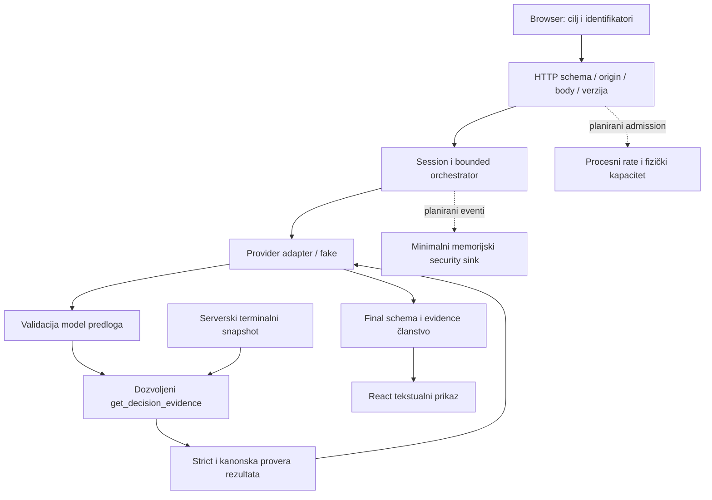

# EVIDENCE_W08 — Secure the Arcade

**Dopuna 2026-10-28:** [Vedranova uspešna lokalna proba i dostavljeni rezultati](evidence/005-vedran-human-check-2026-10-28.md):
coaching, ponovna analiza, AI usage, nova partija i mobilni prikaz potvrđeni;
ručni negativni zahtev HTTP 400. Korisnik je pokrenuo HTTP 37/37, security
123/123 i security browser 6/6 PASS. Formalni deo T030 ostaje otvoren.

## Aktuelni status za predaju — 2026-10-27

**Opseg:** lokalni single-user demo, sintetički podaci i fake provider. Tehnički
checkpoint je `c5038bb`; `main@c2a0d95` dodaje završni dokumentacioni paket bez
promene izvršnog koda. [Paket za predaju](evidence/005-week08-submission.md),
[završna izvršna matrica](evidence/005-phase7-matrix.md) i
[Windows/Linux CI za tehnički checkpoint](https://github.com/milangavric2003/poker-app/actions/runs/40558876322)
razdvajaju kod, lokalne rezultate i hosted provere. T001–T029 i T031–T034 su
završeni; **T030 ostaje otvoren za formalni zajednički demo i individualnu proveru**.
[Naknadni dokumentacioni commit `665fa88`](https://github.com/milangavric2003/poker-app/commit/665fa888c3d13a437a9d77f8b4079a632ae835c8)
ima [Windows/Linux CI PASS](https://github.com/milangavric2003/poker-app/actions/runs/40589947604)
za isti runtime; GitHub run je proveren za taj konkretan SHA.
Vedran i Milan su, prema korisnikovoj potvrdi 27.10, lokalno isprobali aplikaciju
i demo zasebno i zajedno i spremni su za prezentaciju 28.10. Ta potvrda ne navodi
tačne ulaze/ishode njihovih zasebno osmišljenih negativnih slučajeva i ne označava
formalnu odbranu kao izvedenu.
Milan je zatim potvrdio da su **obojica predložila i lokalno izvršila negativnu
proveru povećanja `maxSteps`**. Prethodni [konkretni `maxSteps:999` zapis](evidence/005-milan-human-check.json)
čuva poreklo Codexovog uputstva i Milanovo izvršenje (400/`INVALID_INPUT`,
partija i usage nepromenjeni). Nova potvrda odnosi se na ljudski predlog
slučaja i Vedranovo lokalno izvršenje, ne menja poreklo tog uputstva. Prema
Milanovoj dopuni, Vedran je proverio ulaz, očekivanje, odgovor i stanje partije;
zaseban tačan HTTP izlaz i brojači nisu sačuvani. [Zapis lokalne probe](evidence/005-phase7-demo.md)
razdvaja opažanja oba člana. Formalna individualna varijanta ostaje T030.

### Završni rezultati T00–T17

Sledeći statusi su **izvršeni rezultati**, a ne plan iz istorijskog §5 ispod.
[Matrica](evidence/005-phase7-matrix.md) za svaki red navodi zahtev, izvršnu
kontrolu, naziv testa, komandu, brojače, pozitivnu kontrolu i ograničenje. S =
`npm.cmd run test:security` (123/123), B = `npm.cmd run test:security:e2e`
(5/5 na faznom checkpoint-u), F = `npm.cmd test` (1037/1037 na tom checkpoint-u),
E = `npm.cmd run test:e2e` (26/26 na tom checkpoint-u). Milanova kasnija
[završna provera](evidence/005-week08-submission.md) ima 1040/1040 i 27/27,
uključujući 6 security browser scenarija; to su različiti checkpoint-i.

| Scenario | Konačni status i konkretan ishod | Provera |
|---|---|---|
| T00 | PASS: završena partija, 2 model koraka/1 stvarni read-only alat; poker/facts/RNG nepromenjeni. | S/F, `security-normal.test.ts` |
| T01 | PASS: nevalidan JSON, tip, domen i Origin odbijeni pre provider/tool efekta; validan zahtev prolazi. | S/F, `security-http.test.ts` |
| T02 | PASS: privilegovana polja i 1025 bajtova odbijeni; validna granica 1024 prolazi. | S/F, `security-http.test.ts` |
| T03 | PASS: nepoznata/zastarela partija, ruka ili verzija odbijeni sa 0/0 poziva. | S/F, `security-http.test.ts` |
| T04 | PASS: XSS marker iz validiranog finala ne izvršava kod i ne pravi izvršiv DOM. | B/E, `security-rendering.spec.ts` |
| T05 | PASS: HTML/Markdown/URL/slika ostaju tekst; normalna srpska slova ostaju čitljiva. | B/E, `security-rendering.spec.ts` |
| T06 | PASS: nevalidan i prevelik modelov izlaz/final odbijeni; nema uspeha bez validacije. | S/F, `security-tools.test.ts` |
| T07 | PASS: shell/constructor/toString imaju 0 executor poziva; dozvoljen alat prolazi. | S/F, `security-tools.test.ts` |
| T08 | PASS: loši argumenti i schema-valid focus izvan server scope-a odbijeni pre alata. | S/F, `security-tools.test.ts` |
| T09 | PASS: maliciozan fake predlog ne menja poker i ne izvršava admin alat. | S/F, `security-tools.test.ts` |
| T10 | PASS: extra/sentinel/tuđ tool rezultat ne ulazi u drugi model; kanonski rezultat prolazi. | S/F, `security-tools.test.ts` |
| T11 | PASS: fiksni step/tool/call limiti i zbir retry/fallback pokušaja. | S/F, `security-budgets.test.ts` |
| T12 | PASS: per-call i ukupni deadline, kao i zakašnjeli odgovor, ne daju lažan uspeh. | S/F, `security-budgets.test.ts` i `security-admission.test.ts` |
| T13 | PASS: najviše 2 stvarno aktivna posla i 5 prihvaćenih startova/60 s; oporavak prolazi. | S/F, `security-admission.test.ts` |
| T14 | PASS: učitan sentinel nije u izlazima; forged newline ne stvara lažni događaj. | S/F, `security-secrets.test.ts` i `security-events.test.ts` |
| T15 | PASS: izmenjen browser prikaz/storage/zahtev ne menja serversku partiju ni limite. | B/E, `security-state.spec.ts` |
| T16 | PASS: production CSP blokira dostupan script uz pozitivnu kontrolu; sentinel nije u bundle-u. | B/E, `security-production.spec.ts` |
| T17 | PASS: posao koji ignoriše abort ostaje u kapacitetu; kasni rezultat ne menja novu partiju/usage. | S/F, `security-lifecycle.test.ts` |

### Ista tri ulaza pre i posle

[Doslovna ekvivalencija ulaza](evidence/005-phase7-input-equivalence.json),
[izvorni i završni brojači](evidence/005-phase7-comparison.txt) i
[detaljna tabela](evidence/005-phase7-matrix.md#t006--ista-tri-ulaza) čuvaju
istorijski RED/PASS bez prepravljanja početnih rezultata.

| Scenario | Pre | Posle na tehničkom faznom checkpoint-u |
|---|---|---|
| T07, shell/constructor/toString | PASS: svaki 1 provider/0 tool; dozvoljeni retry 3/1 | PASS→PASS: isti brojači i nepromenjen poker |
| T13, šest startova u 5 s | RED: 6 prihvaćenih/12 provider/6 tool | RED→GREEN: 5 prihvaćenih/10 provider/5 tool; šesti 429 |
| T16, dostupan zabranjeni script | RED: script 200, marker u aplikaciji true, nema CSP violation | RED→GREEN: script 200, marker false, `script-src-elem` enforce violation |

### Završna provera, audit i granice

Završni Milanov checkpoint beleži [1040/1040 testova](evidence/005-milan-final-tests.txt),
[27/27 Chromium E2E i build](evidence/005-milan-final-e2e.txt),
[typecheck](evidence/005-milan-final-typecheck.txt) i
[lint](evidence/005-milan-final-lint.txt) PASS. U ovoj dokumentacionoj sesiji su
na `main@c2a0d95` ponovo lokalno prošli `npm.cmd run test:security` 123/123,
`npm.cmd test` 1040/1040, `npm.cmd run test:e2e` 27/27 uz build, `npm.cmd run
typecheck` i `npm.cmd run lint` (exit 0). Browser test je generisao istorijske
screenshotove; vraćeni su na HEAD i radni direktorijum je ostao čist. Ova sesija
nije ponovila clean install, audit, Linux CI ili živog provajdera.

[Audit odluke](evidence/005-phase6-audit.md) čuvaju početni mrežni problem,
10 pogođenih paketa, ciljane zakrpe i tadašnji konačni rezultat 0 nalaza;
to nije tvrdnja o današnjem novom registry skeniranju. [Sentinel i log događaji](evidence/005-phase6-handoff.md)
provereni su u kontrolisanim error/tool/browser putanjama. Jedan sentinel nije
opšti dokaz protiv svih curenja.

Rate i kapacitet važe samo unutar jednog procesa; događaji su memorijski i
nisu trajni operativni audit. Nema autentifikacije ni korisničkog vlasništva;
UUID partije nije credential. Fake provider ne dokazuje otpornost živog modela,
a abort ne garantuje prekid udaljenog rada ili naplate. Ovaj lokalni demo nije
dokaz spremnosti za višekorisnički deployment. [Operativni README](../README.md)
navodi ove granice pre bilo kakvog izlaganja van lokalnog okruženja.

## Istorijski dnevnik i početni plan (statusi ispod nisu aktuelni)

**Završni dokumentacioni status — 2026-10-27:** implementacija, Git isporuka i
tehnička dokumentacija su završeni; demo/individualni deo spremni su za izvođenje
prema Milanovoj potvrdi. [Paket i konačni linkovi za predaju](evidence/005-week08-submission.md).
Proveren main checkpoint `c5038bb` ima [Windows/Linux CI PASS](https://github.com/milangavric2003/poker-app/actions/runs/40558876322).
PR #12 i #11 su spojeni; #9/#10 zatvoreni. **T031 dokumentacija je završena;
T030 čeka stvarno izvođenje demo-a/individualne provere.** Plan beleži razdvajanje
te dve stavke; nema tvrdnje da je spremnost već izvedeni demo. Statusi ispod su istorijski.

**2026-10-27 — odobrena isporuka i potvrđen doprinos:** Milan je potvrdio
podelu Vedran/`week08-init` i Milan/`fix/week08-finalization`, dodatno ručno
odigrao/proverio aplikaciju kroz `npm run dev` i odobrio push/PR/merge u main.
[Mapa doprinosa, Git tok i granice predaje](evidence/005-week08-delivery.md).
Prethodna formulacija o nepotvrđenoj podeli doprinosa odnosi se na ranije
checkpoint-e. **U ovom tadašnjem checkpoint-u T030/T031 su bili otvoreni**;
kasnije je T031 dokumentaciono zatvoren. Merge/CI ishod tada je tek trebalo
proveriti na povezanim PR-ovima.

**Najnovije 2026-10-27 — T034 i ljudska provera:** browser Zod bootstrap sada
koristi jitless pre shared schema konstrukcije: normalan production tok nema
eval CSP prekršaj, dok kontrolisan eval iz učitane skripte ostaje blokiran.
[RED/GREEN i uzrok](evidence/005-milan-csp-handoff.md).
Završne provere: [full 1040/1040](evidence/005-milan-final-tests.txt),
[build + E2E 27/27](evidence/005-milan-final-e2e.txt),
[typecheck](evidence/005-milan-final-typecheck.txt)/[lint](evidence/005-milan-final-lint.txt) PASS.
Milan je prijavio [stvaran ručni 400/bez efekta i pozitivan coaching](evidence/005-milan-human-check.json).
Asistentski primer nije samostalna ideja testa; **T030/T031 su tada bili otvoreni**.
Promene se čuvaju odobrenim lokalnim commit-om na `fix/week08-finalization`;
novi hosted CI i merge ostaju naredni koraci. Ispod su prethodni checkpoint-i.

**Aktuelno 2026-10-27 — Milanova završna tehnička dorada:** grana
`fix/week08-finalization`, osnova `07db76b`. Reprodukovano odbacivanje sporih
GET odgovora; polling ispravka, RED 2 FAIL/1 PASS → fokus 53 PASS,
puna suite **1040/1040**, build + browser **26/26**, typecheck/lint PASS.
Fake-only `demo:security` i uputstvo pripremljeni i browser probom provereni:
maxSteps extra 400/bez efekta, normalan coaching 2/1, regeneracija, slow GET i mobile.
[Novi handoff, komande i ograničenja](evidence/005-milan-handoff.md),
[ručni pregled](evidence/005-milan-manual.md).
Remote CI za **07db76b** sada je stvarno potvrđen na Windows/Linux:
[run](https://github.com/milangavric2003/poker-app/actions/runs/40409602714),
[API sažetak](evidence/005-milan-remote-ci.json). Lokalne T032/T033 izmene nisu
objavljene i nemaju novi remote CI. **T030 i T031 su tada bili otvoreni.**
Sledeći 2026-10-26 blok je prethodni checkpoint, ne aktuelni CI status.

**Aktuelno 2026-10-26 — Faza 7:** lokalna završna matrica T00–T17 prolazi,
security **123/123**, full **1037/1037**, security Chromium **5/5**, puni E2E
**26/26**, typecheck/lint/build prolaze. Kod/testovi na
`d508f13e4930972d1d64e9d196f69c07ed374027` nisu menjani.
[Matrica pretnja→zahtev→kontrola→test→actual i tri ista pre/posle ulaza](evidence/005-phase7-matrix.md),
[završni handoff, izolovana instalacija i snapshot](evidence/005-phase7-handoff.md),
[konkretan demo i potvrde para](evidence/005-phase7-demo.md).
Workflow zadržava Windows/Linux i dobija security korake/lockfile guard.
T028 i T029 završeni: verna izolovana kopija, nov npm cache i npm ci, nov browser
direktorijum i iste security/full/type/lint/build provere prolaze; lock nepromenjen,
audit **0**. T029 je lokalni izolovani dokaz uz pripremljen CI.
GitHub API za tačan početni HEAD vraća **0 run-ova**; novi radni patch nije objavljen,
remote CI nije PASS. Korisnik potvrđuje da ljudski doprinosi/demo još nisu spremni:
**T030 i tada zavisni T031 bili su otvoreni; Week08 tada nije bio završen.**
Aktuelni rezultati imaju prednost nad istorijskim statusima ispod.

## Istorija prethodnih checkpoint-a (ne predstavlja aktuelni status)

**Aktuelno 2026-10-26 — Faza 6 T023–T027 završena:**
[Handoff i sve komande](evidence/005-phase6-handoff.md),
[audit po paketu/advisory-ju](evidence/005-phase6-audit.md),
[stvarni sanitizovani događaji](evidence/005-phase6-event-examples.json).
Interni allowlist sink: 200 događaja / manje od 30 minuta, pruning pri read/write,
server UUID korelacija, bez raw sadržaja/javnog endpoint-a i usage reset brisanja.
Log injection/dedupe/cancel/late-settle testovi prolaze. Analysis RED→GREEN;
prvi module/setup padovi sačuvani odvojeno od security nalaza.
Sentinel config/factory učitavanje potvrđeno, adapter/tool/normalna putanja PASS→PASS;
extra tool polje zaustavlja drugi model. Kontrolisani production build nema sentinel
u JS/CSS/HTML; **source maps ne postoje**. CSP/header i sentinel/bundle deo imaju
dokaze na istom checkpoint-u: lokalni T16 PASS za testirane putanje, bez opšteg DLP
obećanja. Audit: mrežna prepreka, zatim 10 pogođenih paketa → ciljane kompatibilne
zakrpe → **0 nalaza / exit 0**. Full **1037 PASS**, security **123 PASS**, production
security browser **5 PASS**, typecheck/lint/build/diff-check PASS.
Postojeće phase5-recheck izmene sačuvane. Nema live poziva, commit/push/merge-a.
Sledeći **T028**; clean checkout/remote CI/demo/ljudski review nisu završeni.
Stariji statusi ispod predstavljaju istorijske checkpoint-e.

**Ponovna provera 2026-10-26, HEAD `e498a06`:** T019–T022 već završeni i
potvrđeni bez nove runtime implementacije. [Novi dokaz i komande](evidence/005-phase5-recheck.md).
Prethodna faza 68 PASS, security 108 PASS, UI 125 PASS, security E2E 4 PASS,
pun E2E 25 PASS, oba sa svežim build-om; typecheck/lint PASS. DOM ostaje tekst;
produkcioni CSP blokira dostupan script uz `script-src-elem` enforce violation.
Lokalni T023–T027 su otvoreni i nema njihove Week08 events/secrets implementacije;
status nije vraćen unazad. Puni T16 ostaje otvoren. Sledeći task T023.

**Aktuelno, 2026-10-26 — Faza 5:** T019–T022 završeni na `9d89726` + radni diff.
[Handoff, taskovi, prvi rezultati i komande](evidence/005-phase5-handoff.md).
T04/T05: oba panela već bezbedno prikazuju tekst, **PASS→PASS**, bez runtime izmene.
Validan fake final prolazi stvaran alat i backend validaciju: 2 model koraka/1 alat.
HTML/event/script/Markdown/javascript i dostupna spoljašnja slika ostaju literalni
tekst; scoped DOM nema izvršive elemente/event atribute, marker izostaje,
navigacija/poker su očuvani i automatskih zahteva prema probe serveru ima 0.
Srpski č/ć/š/ž/đ, apostrof i `a < b` ostaju sačuvani.
T16 CSP/header deo **RED→GREEN**: isti `/security-probe.js` i marker kao T006,
bez politike HTTP 200 + marker true; u preview aplikaciji marker false,
`script-src-elem` enforce violation za konkretan URL, HTTP broj ostaje 2→2
(pre politike 2→3). Zaglavlja dolaze iz stvarnog `vite.config.ts` `preview.headers`,
uključuju aktivnu tačnu CSP iz plana, nosniff i no-referrer. Igra, JS/CSS asset-i,
kontrole, mobile širina i validan coaching rade pod istom politikom.
`test:security:e2e`: build + **4 PASS**; `test:e2e`: svež build + **25 PASS**;
security node **108 PASS**, fokusirana prethodna faza **68 PASS**, security/UI
**233 PASS**, typecheck/lint/build PASS. Prvi full E2E imao je 24 PASS/1 harness
ENOENT zbog preklopa runner-a i trace direktorijuma; sačuvan, zatim serijski 25 PASS.
Istorijski feature004 screenshot-i vraćeni iz lokalnog početnog backup-a.
**Puni T16 nije završen**: sentinel/server-secret/bundle/events ostaju T025–T026.
Nema novih live poziva, ključeva, paketa, commit/push/merge-a. Sledeći **T023**.
Stariji zapisi ispod su istorijski checkpoint-i.

**Aktuelno, 2026-10-26 — Faza 4:** T013–T018 završeni na `cc0d3fb` + radni diff.
[Handoff, svi taskovi, prvi padovi i komande](evidence/005-phase4-handoff.md).
Budžeti/scope/terminal/usage guard-ovi PASS→PASS; dodat serverski coaching output
cap 4096 tokena i procesni admission/lease: 5 coach/analysis startova u kliznih
60 s, najviše 2 stvarna provider posla zajedno sa botovima. Lease traje do settle
originalnog promise-a, odvojeno od terminalnog run-a; nema queue-a niti reset-a
kroz novu partiju/usage. T17 late resolve/reject prelazi obe granice.
UI odbijanje čuva summary/partiju i omogućava eksplicitan retry.
Full: **1022 PASS**, security: **108 PASS**, fokusirana regresija **212 PASS**,
browser **11 PASS**; typecheck/lint/build PASS. Prvi setup/lint/browser problemi
sačuvani i odvojeni od stvarnih adapter/admission/UI RED nalaza.
Isti početni T13 ulaz: **6/12/6 → 5/10/5** prihvaćenih/provider/tool;
[actual](evidence/005-phase4-T13-same-input.txt). T16 CSP i dalje očekivani FAIL
u zasebnom production testu. SDK byte provera je naknadna posle buffering-a;
neotkaziv posao može zauzeti mesto do restarta. Sledeći **T019**.
Stariji zapisi ispod predstavljaju prethodne checkpoint-e, ne aktuelni status.

**Aktuelno, 2026-10-26 — Faza 3:** T008–T012 završeni na `2b8ea4e` + radni diff.
[Handoff, task statusi, komande i ograničenja](evidence/005-phase3-handoff.md).
Novi HTTP/model/tool/scope/schema/browser testovi potvrđuju postojeće kontrole;
runtime nije menjan (PASS→PASS). Fokusirana regresija 236 PASS, novi state browser
i recovery 7 PASS. `test:security`: 80 PASS/1 očekivani T13 FAIL; full `npm test`:
986 PASS/1 očekivani T13 FAIL. Produkcioni T16 ponovljen: očekivani CSP RED.
Typecheck/lint/build PASS; prvi browser assertion i test-instrumentation typecheck
padovi sačuvani, nisu security nalazi. T00–T03/T06–T10/T15 i origin imaju lokalni
dokaz ove faze; puna završna W08 matrica ostaje otvorena. Sentinel je samo extra
tool-field dokaz, bez tvrdnje o punom secret/bundle/log auditu. Sledeći **T013**.
Stariji pasusi ispod opisuju istorijske checkpoint-e.

**Datum pripreme: 2026-10-25. Status: plan i lokalna osnova spremni; Week08 nije završen.**
**Dopuna 2026-10-26:** T004 završen na osnovi commita `0d361f1`; sačuvan
[početni prompt](BUILD_PROMPT_WEEK08_V1.md), potvrđeni T001–T003 i ponovljene
fokusirane provere: 57 testova i 6 recovery E2E PASS. [T004 dokaz](evidence/005-T004-handoff.md).
Ovo je istorijski T004 checkpoint; aktuelni status Faze 2 je ispod.
Struktura prati nastavni šablon. Planirano nije izvršeno; stare W05/privatne
dorade nisu novi W08 doprinos. Finalnu matricu popunjavati stvarnim opažanjima.

**Faza 2, 2026-10-26:** T005–T007 završeni na `d08e06c` + radni diff.
[Handoff i sve komande](evidence/005-phase2-handoff.md),
[tačni ulazi/očekivanja i prvi padovi](evidence/005-phase2-expectations.md),
[SHA256 fixture manifest](evidence/005-phase2-fixtures.json).
T00 PASS (2 provider/1 stvarni tool, validan final, read-only poker),
T07 shell/constructor/toString PASS (svaki nedozvoljeni executor 0, pozitivan retry 1).
T13 početni RED: accepted 6/provider 12/tool 6 u 5 s umesto maksimuma 5/10/5.
T16 početni RED: script 200 i kontrolni marker true; app marker true,
violations [], bez CSP, broj script zahteva 2→3. Kontrole ostaju otvorene.
`npm run test:security` postoji i trenutno izlazi 1 (4 PASS/1 T13 FAIL).
Običan `npm test`: 910 PASS/1 očekivan T13 FAIL; typecheck/lint/build PASS.
Prvi setup/type/lint padovi ostaju sačuvani; nisu predstavljeni kao security RED.
Završna T00–T17 matrica i sva posle poređenja tada su još NOT RUN. Sledeći
task bio je **T008**.

## 1. Opseg i checkpoint

- Tim: Veki i Milan; stvarni rad/review u §10.
- Projekat: Retro Poker, postojeći W05 „Coaching partije”, read-only alat
  `get_decision_evidence`, dva modelska koraka; fake provider i sintetički podaci.
- Repo: `poker-app`, Git koren roditelj `retro-poker/`.
- Početni branch/commit: `week08-init`, `96fb9715098d8a3bf857103c855335b302a30d36`.
  Isti commit kao `add-modifications`; frontend PR prema korisniku čeka Milanov review.
- `git fetch origin` izvršen 2026-10-25; `origin/main` je
  `c73ae8c1a995122987eb54662536ab11488ad6f6`, review tip
  `2574a0aeb64a592b91882569629f8b8dc6cccf96`. PR status nije nezavisno čitan preko GitHub API-ja.
- Posle selektivnog prenosa: isti HEAD + [patch osnove](evidence/005-baseline-transfer.patch)
  i [hash manifest](evidence/005-baseline-snapshot.json). Nije napravljen novi commit,
  main/PR nisu merged; root korisnički `.gitignore` sačuvan.
- Završni W08 checkpoint: **još ne postoji**.
- Windows, Node 24.20.0/npm 11.19.0; Chromium iz Playwright 1.63.0.
- Lokalni jedan proces/jedna partija u memoriji, loopback, bez naloga/cookie auth-a
  ili privatne multi-user arhive. To nije zaštita od drugih lokalnih procesa.

| Početna provera | Stvarni ishod | Dokaz |
|---|---|---|
| `npm.cmd test` pre prenosa | FAIL: 905/906, 61/62 fajla; offline CLI test timeout 5 s | [prvi izlaz](evidence/005-baseline-tests-before.txt) |
| Recovery E2E pre prenosa | PASS 5/5 | [prvi recovery](evidence/005-baseline-recovery-before.txt) |
| `npm.cmd test` posle prenosa | PASS 906/906, 62 fajla | [testovi](evidence/005-baseline-tests-after.txt) |
| Puni E2E posle prenosa | PASS 20/20, uključujući novi slow-forward recovery | [E2E](evidence/005-baseline-e2e-after.txt) |
| Typecheck / lint / build | PASS, exit 0 za svaku komandu | [typecheck](evidence/005-baseline-typecheck.txt), [lint](evidence/005-baseline-lint.txt), [build](evidence/005-baseline-build.txt) |
| Postojeći coach evidence helper | Sandbox pokušaj nije startovao zbog tsx/OS ENOMEM; odobren ponovni offline run exit 0, osam scenarija | [prvi pokušaj](evidence/005-baseline-coach.txt), [stvarni run](evidence/005-baseline-coach-retry.txt) |
| Clean `npm ci` / novi GitHub CI | NOT RUN u ovoj pripremi | Otvoren T029; postojeći node_modules nije clean-install dokaz |

Normalan baseline fixture je versionisan u `tests/helpers/coach-evidence.ts`:
game `00000000-0000-4000-8000-000000000001`, hand `...0002`, expectedVersion 5,
factsRevision 1, status lost, jedna flop call odluka, goal street, fake
`agent_tool`→`agent_final`, stvarni lokalni executor. Očekivanje unapred zapisano:
completed, 2 model koraka/2 pokušaja/1 stvarni alat, nepromenjen snapshot.
Stvarni helper run to potvrđuje. Lifecycle test u full suite-u dodatno koristi
kontrolisan all-in kraj partije i poredi kompletno poker stanje. Ovo je dokaz
funkcionalne osnove; nije završna W08 matrica niti live provider dokaz.

Detaljan prenos i reprodukcija: [baseline](evidence/005-baseline.md).

## 2. Arhitektura i inventar podataka

Isprekidane veze još nisu implementirane. HTTP trust boundary je browser→server;
provider i tool izlaz su nepoverljivi čak i kada u testu dolaze iz fake-a.

| Podatak/capability | Ko kontroliše | Provera/upotreba | Ide modelu? | Čuvanje / razlog |
|---|---|---|---|---|
| goal.focus | Browser predlaže | Strict enum + vezivanje run/tool focus-a | Da | Run u memoriji, korisnikov fokus |
| gameId/handId/version | Browser šalje; server autoritet | Session poređenje sa aktuelnom partijom | Ne kao ovlašćenje; evidence ref može sadržati handId | Identifikacija resursa, nije session/bearer token |
| factsRevision/snapshot | Server | Zamrznut terminalni snapshot, canonical validators | Samo dozvoljena projekcija | Tekuća partija/run, do zamene/restarta |
| Činjenice odluka | Server engine | Do 200 odluka, tool izbor do 10; dozvoljene činjenice | Da, odabrane sopstvene/javne informacije | Koristan coaching bez cele arhive |
| Špil, burn/skrivene tuđe karte, RNG | Server | Public view i knowledge projection | Ne | Interna igra, bez response/model/log izvoza |
| Tool name/args | Model predlaže | Allowlist, strict args, scope pre izvršenja | Predlog/validirani rezultat | Run, ne operativni raw log |
| Tool output/final | Nepouzdan output | Byte/schema/canonical članstvo pre nastavka/UI-ja | Samo validan tool output drugom modelu | Bounded run rezultat; plain text UI |
| Model/API config i ključ | Server env/adapter | Fiksan config, SDK mock/sentinel test planiran | Ključ ne ide u model context | Proces; tajne nisu deo test fixture-a |
| Browser state/URL/storage | Korisnik može menjati | Nisu kanonski izvor poker stanja; nema učitavanja partije iz storage-a | Ne direktno | UI stanje; T15 proverava granicu |
| AI usage | Serverski brojači | Epoch/revizija, dashboard/reset | Ne | Memorija do reset/restart; nije security audit |
| Greške/security događaji | Server iz nepoverljivih događaja | Safe code i planirana allowlist event schema | Ne | Plan: max 200/30 min, lokalni proces, bez javnog endpoint-a |

Nema korisničkog imena/slobodnog coaching teksta, replay importa, SQL-a ili RAG-a
na izabranom toku. Ne dodavati izmišljene izvore u dijagram. Postojeće tekstualne
provider rezultate ipak tretirati kao nepoverljive.

## 3. Model pretnji i prioriteti

Procena je kvalitativna za lokalni demo, ne potvrđena eksploatacija.

| ID | Scenario i preduslov | Resurs; verovatnoća × uticaj | Postojeća kontrola / nedostatak | Planirani dokaz | Prioritet |
|---|---|---|---|---|---|
| R1 | Lokalni klijent šalje više uzastopnih coach/analysis startova mimo dugmeta | Provider rad/trošak; srednja × visoka: direktan endpoint lako ponoviti | Run budžet i dedupe; nema cross-request rate prozora | T13, 5/60 s i legitimni oporavak | **1** |
| R2 | Provider ignoriše abort; korisnik menja partiju i pokreće novi posao | Procesni kapacitet; srednja × visoka: stale zaštita ne prekida nužno rad | Race/abort i stale guard; treba meriti stvarni active maximum | T12/T13/T17 | **2** |
| R3 | Validan final sadrži script/event HTML ili opasni link | Browser igrača; niska × visoka: React tekst je dobra kontrola, production CSP nedostaje | Plain text; nema CSP/header browser dokaza | T04/T05/T16 | **3** |
| R4 | Klijent dodaje model/maxSteps/role ili podmeće poker stanje | Autoritet/stanje; srednja × visoka: zahtevi su izmenljivi | Strict schema i server state | T01–T03/T15, pozitivni control | Ostalo obavezno |
| R5 | Model predloži inherited tool ili validne args van run scope-a | Alati/podaci; srednja × visoka: model nije pouzdan | Zatvoren name dispatch, snapshot/goal provere | T07–T09, real executor spy | Ostalo obavezno |
| R6 | Tool vrati tuđe facts/extra secret polje ili adapter raw grešku | Poverljivost; niska × visoka: postoje projekcija i safe errors | Canonical validator; sentinel dokaz nedostaje | T10/T14/T16 | Ostalo obavezno |
| R7 | Raw tool name sa novim redom postane operativni log | Integritet evidencije; srednja × srednja ako se uvede raw logging | Nema novog security sink-a; dizajn mora izbeći raw log | T14, bounded event schema | Ostalo obavezno |

Prva tri daju najveću korist nad trenutno nedokazanim granicama. Ostali se ne
preskaču. Multi-user BOLA/SQL injection/RAG import nisu izabrane putanje jer te
funkcije ne postoje; UUID i loopback se ne predstavljaju kao autentikacija.

## 4. SpecKit/SDD invarijante i granice

Spec: [feature 005](../specs/005-week08-secure-the-arcade/spec.md).
Jedina tabela konkretnih limita: [plan](../specs/005-week08-secure-the-arcade/plan.md).
Ugovor: [security](../specs/005-week08-secure-the-arcade/contracts/security.md).

| Invarijanta | Mesto postojeće / planirane kontrole | Zahtev i dokaz |
|---|---|---|
| I1 | app/routes/session input i planirani admission | FR-002/003/013; T01–T03/T13 |
| I2 | strict shared schema, server config/snapshot | FR-002/003/006; T02/T08/T15 |
| I3 | orchestrator/tools/validation | FR-004/005; T06–T10 |
| I4 | snapshot, canonical state i lifecycle | FR-001/003/007; T00/T12/T15/T17 |
| I5 | tekstualni paneli + planirani preview headers | FR-009/010; T04/T05/T16 |
| I6 | run limits + planirani gate/lease/output token cap | FR-006–008; T11–T13/T17 |
| I7 | allowlist projections/errors + planirani events/sentinel | FR-005/011–014; T10/T14/T16/audit |
| I8 | normalan fake tok i full regresija | FR-001/015; T00 i završne provere |

Ovo je mapa implementacije, ne lista završenih kontrola. Konkretni test fajlovi
i tačni izvršeni testovi dopunjavaju se po tasks-u.

## 5. Početna matrica scenarija T00–T17 (istorijski plan)

Na početnom checkpoint-u 25–26.10. svi završni redovi su bili **NOT RUN**.
To je sačuvan plan pre implementacije, ne aktuelna ocena. Izvršeni statusi
T00–T17 i link na završnu matricu nalaze se na početku ovog dokumenta.
Postojeći baseline signali nisu automatski preneti u završne PASS ocene.

| ID | Fixture/ulaz i očekivanje pre testa | Početno opažanje / planirani test | Tadašnji final |
|---|---|---|---|
| T00 | Sintetička terminalna partija, 2 model koraka/1 real tool, read-only | Faza 2 security-normal PASS: terminal lost [0,2000], completed, provider 2/real tool 1, poker identičan | NOT RUN |
| T01 | Nevalidan JSON/tip/domain, pozitivan boundary; 0/0 poziva | `security-http.test.ts`; postojeći route testovi su samo osnova | NOT RUN |
| T02 | Odvojeno oversized body i extra privilege polja; 0/0 | `security-http.test.ts` | NOT RUN |
| T03 | Nepoznata/zastarela partija; dozvoljena trenutna prolazi | `security-http.test.ts`; single-user scope, bez fiktivnog auth-a | NOT RUN |
| T04 | Final sa XSS markerom i normalnim tekstom; bez izvršenja/opasnog DOM-a | `security-rendering.spec.ts`, pravi browser | NOT RUN |
| T05 | HTML/Markdown/javascript link/image; neaktivni tekst | `security-rendering.spec.ts` | NOT RUN |
| T06 | Invalid/oversized model, nema success/novog koraka | `security-tools.test.ts` | NOT RUN |
| T07 | Unknown/constructor/toString, nula tool efekata, validan tool prolazi | Baseline unknown_tool PASS u helper-u; inherited varijante tek slede | NOT RUN |
| T08 | Loši args i zasebno validan args/pogrešan scope | `security-tools.test.ts` | NOT RUN |
| T09 | Malicious fake predlog uprkos promptu | `security-tools.test.ts`; nema slobodnog input kanala | NOT RUN |
| T10 | Oversized/invalid/extra sentinel/tuđ tool rezultat; nema sledećeg model curenja | `security-tools.test.ts` + secrets | NOT RUN |
| T11 | Ponavljanje i ukupni attempts/retry/fallback odvojeno | `security-budgets.test.ts`; helper ima samo deo baseline scenarija | NOT RUN |
| T12 | Per-call, zbirni deadline i late rezultat zasebno | `security-budgets.test.ts` + lifecycle | NOT RUN |
| T13 | Overlap maximum i 5/60 prozor odvojeno, recovery | `security-admission.test.ts`, capacity test | NOT RUN |
| T14 | Učitan sentinel u grešci/tool polju + forged log newline | `security-secrets.test.ts` + events | NOT RUN |
| T15 | Izmenjen browser zahtev/state/storage bez serverskog efekta | `security-state.spec.ts` + HTTP test | NOT RUN |
| T16 | Build/header/CSP/sentinel, dostupan zabranjeni script + normalna igra | `security-production.spec.ts`; sadašnji build PASS nije CSP dokaz | NOT RUN |
| T17 | Noncooperative job→new game/reset→new start→late result | `security-lifecycle.test.ts`; prelazi resursnu i state/usage granicu | NOT RUN |

T00–T15 i T17 automatizovati. T04/T05 stvaran browser, T16 automatizacija ili
precizni ručni dokazi. Po izvršenju upisati stvarne brojače, state comparison,
komandu i checkpoint, ne samo status. Odbijen početni HTTP: provider/tool 0/0;
odbijen model proposal može imati provider 1, ali nedozvoljeni tool 0.

### CSRF i origin

Pregledani kod nema automatski auth cookie/credential; credential CSRF je
arhitektonski N/A, ne izvršeni PASS. Cross-origin cost test ipak obavezan:
drugi lokalni Origin/null → 0 provider/0 tool; validan origin → normalan tok.
SQL N/A jer nema baze. Ako se model promeni, ove odluke ponovo otvoriti.

### Dependency audit — početni plan

Tada **NOT RUN**. T027 je kasnije upisao komandu/exit, paket, stvarnu lockfile
verziju, advisory, runtime/dev uslov izloženosti i odluku
(fixed/mitigated/N/A uz dokaz/open).
Stvarni rezultat je povezan u aktuelnom delu na početku. Nedostupna mreža
nije clean audit. Ne koristiti `audit fix --force`.

## 6. Početni plan poređenja pre/posle

Najmanje tri scenarija, isti fixture/ulaz. T006 ih izvršava pre security koda.
Prenos review test infrastrukture ne predstavlja tri security popravke.

| Scenario | Pre checkpoint/ulaz/rezultat | Promena | Posle isti ulaz/rezultat | Ograničenje |
|---|---|---|---|---|
| T07 unknown/inherited tool | d08e06c + Faza 2 fixture; PASS shell/constructor/toString, svaki provider 1/tool 0; dozvoljeni retry ukupno 3/1 | Postojeća zaštita, bez runtime izmene | NOT RUN | Ne dokazuje sve model generacije; proširenje T010 ostaje otvoreno |
| T13 burst accepted starts | d08e06c + Faza 2; [0,1000,2000,3000,4000,5000] ms, RED: 6 prihvaćenih/12 provider/6 tool | Planirani rate/capacity gate još nije uveden | NOT RUN | Početni rate dokaz; puna concurrency/reset/recovery matrica ostaje T015 |
| T16 CSP blocked script | d08e06c + Faza 2; script 200/control marker true; RED app marker true/violations [], nema CSP, HTTP 2→3 | Planirana preview HTTP zaglavlja još nisu uvedena | NOT RUN | Lokalni build; puna browser/coaching/sentinel matrica ostaje T021/T025 |

## 7. Početni plan: arhitektura, tajne i security događaji

Plan iz 25.10: admission/capacity i mali memorijski event sink u `backend/src/security/`.
Bez novog servisa ili javnog log API-ja. Fake se ubrizgava konstruktorom; normalan
backend koristi postojeći adapter. Sentinel `W08_SERVER_SECRET_DO_NOT_EXPOSE`
je planirana sintetička vrednost, ne pravi ključ.

Na početnom checkpoint-u još nije bilo izvršenog sentinel testa ni stvarnog
W08 accepted/rejected event primera niti dokaza retention-a. T023–T026 ih
popunjavaju. Predviđeno čitanje događaja:
lokalni proces/operator/test sink; max 200/30 min, bez trajnog zapisivanja,
restart uklanja buffer, usage reset ga ne briše. Jedan sentinel nije opšti DLP.

## 8. Početni plan ponovljivosti i isporuke

[Quickstart](../specs/005-week08-secure-the-arcade/quickstart.md) je tada razlikovao postojeće
komande od planiranih `test:security` i `test:security:e2e` koje još nisu postojale.
Početne rezultate videti u §1 i [machine-readable rezultatima](evidence/005-baseline-results.json).
Dokumentacija je proverena: [linkovi/taskovi/snapshot](evidence/005-document-check.json)
i [patch/diff check](evidence/005-final-check.txt), bez grešaka.
Na tom početnom checkpoint-u clean install, security/full suite, browser
production, audit i remote CI još nisu bili izvršeni. Kasniji ishodi su na
početku dokumenta i u povezanim završnim dokazima.

## 9. Zaključci početnog checkpoint-a (istorijski)

- Dokazano: lokalna post-transfer regresija 906 testova/20 E2E + typecheck/lint/build;
  postojeći fake coaching dva koraka/jedan alat i read-only rezultat.
- Prvi test pad sačuvan: offline CLI timeout pri početnoj konfiguraciji. Posle
  worker limita suite prolazi; to nije dokaz da više nikad neće biti timeout-a.
- Pregledano, ne dokazano W08 matricom: schema/scope/text render granice.
- Nisu implementirani: novi gate, output token cap, security sink i produkciona
  zaglavlja. Nisu izvršeni: sentinel, audit, tri security pre/posle i finalni CI/demo.
- Abort ne dokazuje prekid udaljene naplate; fake ne dokazuje live prompt-injection
  otpornost, stratešku optimalnost ili produkcijsku dostupnost.
- T004 je završen 26.10.2026; sledeći korak je T005, zatim T006–T007 pre hardening-a.

## 10. Početna evidencija doprinosa para i AI odgovornosti

Tabela ispod čuva stanje pripreme 25.10. Potvrđena kasnija podela rada je u
[završnoj isporuci](evidence/005-week08-delivery.md); lokalna proba i preostala
formalna odbrana su u aktuelnom delu ovog dokumenta.

| Član | Stvarno potvrđeno u ovoj pripremi | Kontrola / samostalni negativni test / review |
|---|---|---|
| Veki | Dao zahteve, razjasnio privatne dorade i zatražio feature/prenos osnove | Implementacioni doprinos i individualni test još nisu potvrđeni |
| Milan | Prema Vekiju kolega u paru; istorijska review grana analizirana | Novi W08 doprinos/review/demo još nisu potvrđeni |

Codex je pripremio dokumente, selektivni prenos i lokalne provere. To se ne
pripisuje ljudima kao samostalno osmišljen test. Oba člana naizmenično vode taskove,
svako mora doprineti najmanje jednoj kontroli i jednom negativnom testu.
AI model identitet/potrošnja ove sesije nisu dostupni; nepoznato.
Novi živi Gemini pozivi: 0. [AI log](AI_USAGE_LOG.md), [manifest](CONTEXT_MANIFEST.md).

## 11. Dodatni izazov

Nije izabran. Najviše jedan tek po zatvaranju obaveznog dela; nije uslov ovog plana.
